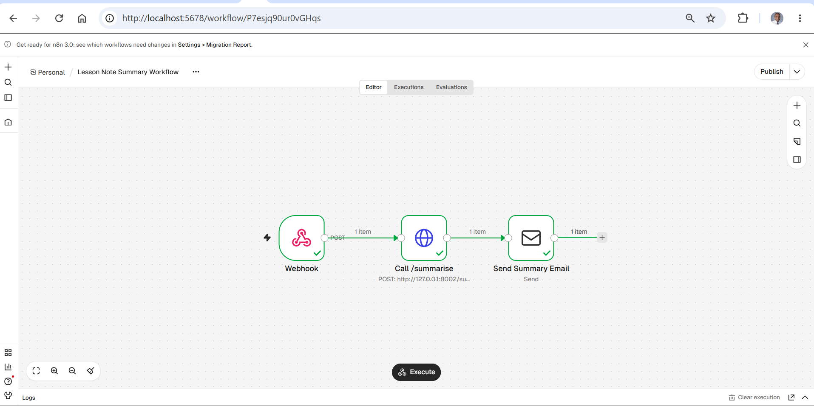
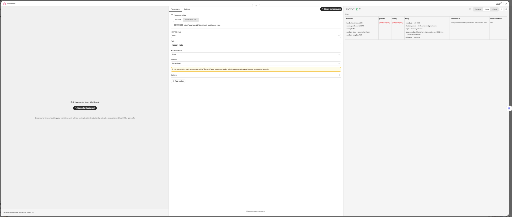
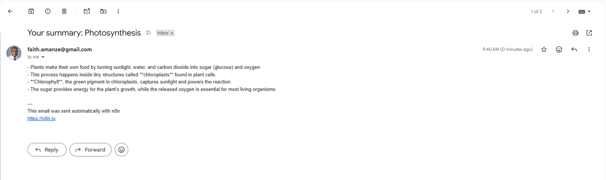

# Lesson Note Summary Automation

> An n8n workflow that receives a lesson note through a webhook, sends it to a FastAPI backend that summarises it with Groq, and emails the summary to the student.



## Problem

Lesson notes are often long. Students want a short version they can review quickly, and tutors do not want to write summaries by hand for every lesson.

## Solution

A tutor-side system (or any script) sends a lesson note to an n8n webhook. n8n forwards it to a secured FastAPI endpoint, which asks Groq for a short bullet summary. n8n then emails that summary to the student. The whole path runs automatically from one POST request.

## Features

- Webhook intake of lesson notes (`event_id`, `student_email`, `topic`, `lesson_note`, `difficulty`)
- FastAPI `POST /summarise` endpoint backed by Groq (`openai/gpt-oss-120b`)
- Summary delivered by email through n8n (SMTP / Gmail)
- API key protection with the `x-api-key` header (401 on a wrong or missing key)
- Input validation (400 on an empty `lesson_note`)
- Idempotency by `event_id` (a repeated event returns the saved summary, with no second AI call)
- `USE_GROQ=false` mode for testing the plumbing without calling the AI

## Tech stack

| Layer | Tool |
|---|---|
| Orchestration | n8n (Webhook, HTTP Request, Send Email nodes) |
| Backend | Python, FastAPI, Uvicorn |
| AI | Groq API, `openai/gpt-oss-120b` |
| Email | SMTP (Gmail app password) |
| Tests | pytest, GitHub Actions, PowerShell script using `curl.exe` |

## Setup (Windows / PowerShell, local)

This project runs locally. It is not deployed.

### 1. Backend

```powershell
pip install -r requirements.txt
Copy-Item .env.example .env      # then edit .env
uvicorn main:app --port 8002 --reload
```

Check it is up: `curl.exe http://127.0.0.1:8002/health` returns `{"status":"ok"}`.

### 2. n8n

```powershell
npm install -g n8n
$env:NODE_OPTIONS="--dns-result-order=ipv4first"
n8n
```

Open http://localhost:5678, then:

1. Import `n8n-workflow.json`.
2. In **Call /summarise**, set the `x-api-key` header to the same value as `API_KEY` in your `.env`.
3. In **Send Summary Email**, create an SMTP credential: host `smtp.gmail.com`, port `587`, SSL/TLS off, your Gmail address, and a Gmail app password. Set From Email to your Gmail address.

### 3. Run it

Click **Execute workflow** in n8n, then within about a minute send:

```powershell
'{"event_id":"evt-100","student_email":"you@example.com","topic":"Photosynthesis","lesson_note":"Plants turn light, water and CO2 into sugar and oxygen.","difficulty":"beginner"}' | Set-Content -Encoding ascii webhook.json

curl.exe -X POST http://localhost:5678/webhook-test/lesson-note -H "Content-Type: application/json" -d "@webhook.json"
```

Use a new `event_id` for every run.

## Environment variables

Copy `.env.example` to `.env`. Never commit `.env`.

| Variable | Meaning |
|---|---|
| `API_KEY` | Secret the caller must send in `x-api-key`. Make up a long random value. |
| `USE_GROQ` | `false` returns a placeholder summary. `true` calls Groq. |
| `GROQ_API_KEY` | Your Groq key (needed when `USE_GROQ=true`) |
| `GROQ_MODEL` | Defaults to `openai/gpt-oss-120b` |

## Test command

With the backend running:

```powershell
.\test_requests.ps1
```

It checks the happy path (200), empty text (400), wrong key (401), and a repeated `event_id` (identical response). The same checks also run as a six-test pytest suite in `tests/test_api.py` (`pip install pytest httpx`, then `python -m pytest -v`) and on every push through GitHub Actions.

## API example

`POST /summarise` with header `x-api-key`:

```json
{
  "event_id": "evt-100",
  "student_email": "you@example.com",
  "topic": "Photosynthesis",
  "lesson_note": "Plants turn light, water and CO2 into sugar and oxygen.",
  "difficulty": "beginner"
}
```

Response (200):

```json
{ "event_id": "evt-100", "summary": "- Plants make food from light, water and CO2 ..." }
```

| Status | Meaning |
|---|---|
| 200 | Summary returned |
| 400 | `lesson_note is empty` |
| 401 | `Bad or missing API key` |
| 422 | Invalid JSON or missing fields |

## Screenshots

| Webhook output | Final email |
|---|---|
|  |  |

## Documentation

- [Final product review](docs/final-product-review.md)
- [Release checklist](docs/final-release-checklist.md)
- [Architecture](docs/architecture.md)
- [Portfolio case study](docs/portfolio-case-study.md)
- [Demo script](docs/demo-script.md)
- [Interview answers](docs/interview-answers.md)
- [LinkedIn post draft](docs/linkedin-post.md)
- [Full test and error report](docs/automation-workflow-report.md)

## Known limitations

- Idempotency uses an in-memory dictionary, so it resets when the server restarts.
- n8n would still send a second email for a repeated event, because the duplicate check lives in the backend.
- Local setup only, with no hosted deployment.

## Author

Faith Amanze. Built solo with the help of an AI coding assistant. [GitHub](https://github.com/faith-amanze)