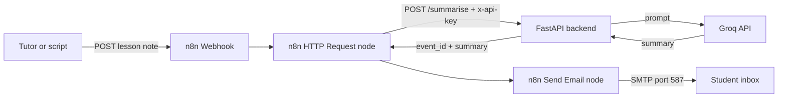

# Architecture

## System diagram

## Components

| Component | Role |
|---|---|
| n8n Webhook | Receives the lesson note at `/webhook/lesson-note` |
| n8n HTTP Request | Builds the JSON body and calls the backend |
| FastAPI `/summarise` | Checks the API key, validates input, checks idempotency, calls Groq |
| Groq | Generates the bullet summary (`openai/gpt-oss-120b`) |
| n8n Send Email | Emails the summary through SMTP |

## Key request flow: one lesson note, start to email

1. A tutor or script sends `POST /webhook/lesson-note` with `event_id`, `student_email`, `topic`, `lesson_note`, `difficulty`.
2. The n8n Webhook node receives it. The fields arrive under `body`, so expressions use `$json.body.<field>`.
3. The HTTP Request node builds the request body with `JSON.stringify`, so quotes or line breaks in a note cannot break the JSON.
4. It sends `POST http://127.0.0.1:8002/summarise` with the `x-api-key` header.
5. FastAPI checks the key. A wrong or missing key returns **401**.
6. FastAPI checks `lesson_note`. An empty note returns **400**.
7. FastAPI checks whether `event_id` was already processed. If yes, it returns the saved summary and stops.
8. Otherwise it sends the note to Groq, which returns a short bullet summary.
9. FastAPI saves the result under `event_id` and returns `{"event_id", "summary"}`.
10. The Send Email node emails the summary to `student_email` with the subject `Your summary: <topic>`.

## Data storage
No database. Processed `event_id` values and their summaries are kept in an in-memory dictionary in the FastAPI process. It resets when the server restarts. Production would use a database or Redis.

## Error handling summary

| Situation | Behaviour |
|---|---|
| Wrong or missing key | 401 `Bad or missing API key` |
| Empty note | 400 `lesson_note is empty` |
| Invalid JSON or missing fields | 422 |
| Repeated `event_id` | 200 with the saved summary, no new AI call |