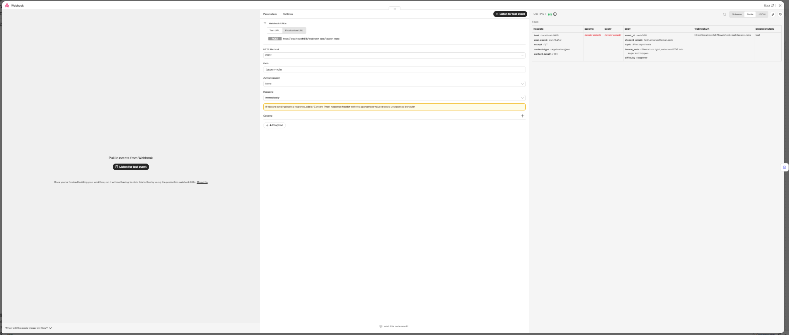
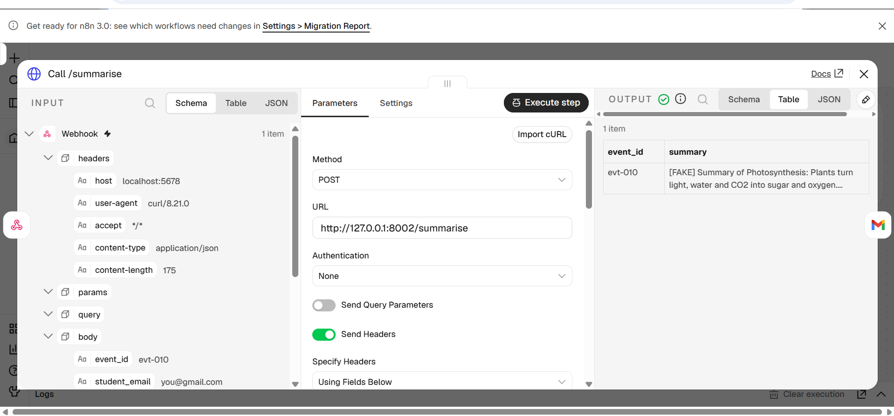
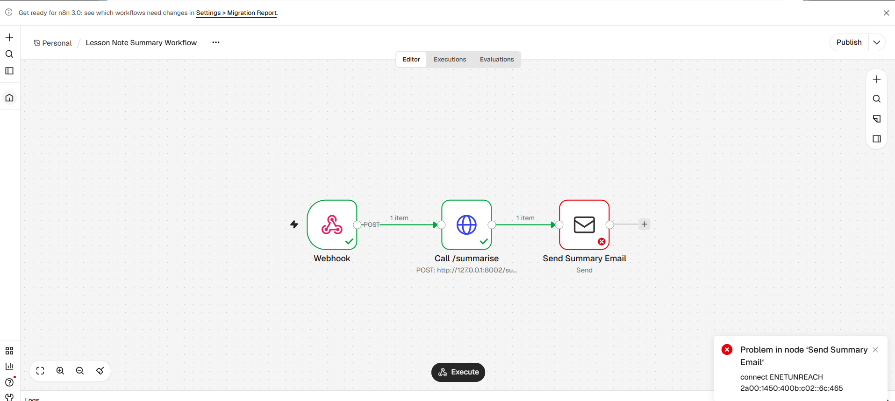
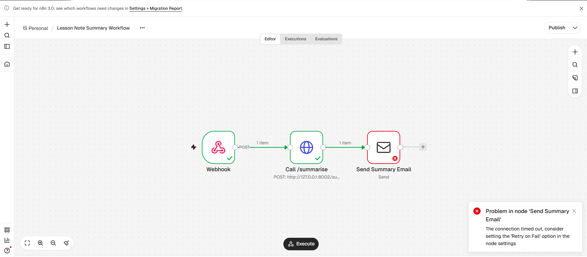
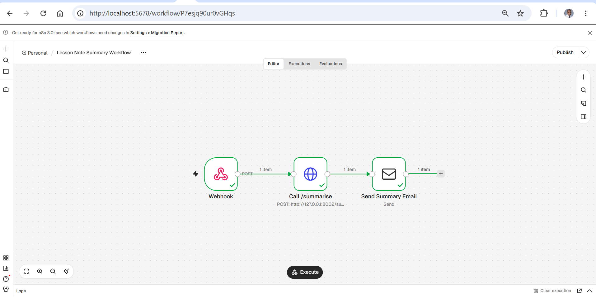
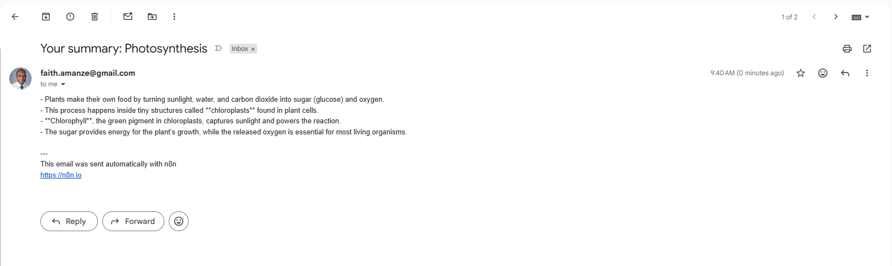

# Automation Workflow Report

**Author:** Faith Amanze

**Date:** 13 November 2026

**Stack:** n8n (webhook, HTTP Request, Send Email/SMTP), FastAPI backend, Groq (`openai/gpt-oss-120b`; the first real-AI runs used `llama-3.3-70b-versatile`)

## 1. Workflow Diagram

```
trigger:          n8n Webhook receives POST /webhook/lesson-note
-> action:        n8n maps the webhook body into a JSON request
-> AI processing: HTTP Request node calls POST /summarise on the FastAPI backend (x-api-key header); backend asks Groq for a summary
-> delivery:      n8n emails the summary to student_email (SMTP, Gmail)
```

## 2. Input Fields and Mapping

| Webhook field | Example | API body field | n8n expression |
|---|---|---|---|
| event_id | evt-020 | event_id | `{{ $json.body.event_id }}` |
| student_email | faith.amanze@gmail.com | student_email | `{{ $json.body.student_email }}` |
| topic | Photosynthesis | topic | `{{ $json.body.topic }}` |
| lesson_note | Plants turn light, water and CO2 into sugar and oxygen. | lesson_note | `{{ $json.body.lesson_note }}` |
| difficulty | beginner | difficulty | `{{ $json.body.difficulty }}` |

The HTTP Request body is built with `JSON.stringify({...})` so quotes or line breaks in a lesson note cannot break the JSON. Webhook data arrives under `body`, which is why every expression starts with `$json.body`.

Email node: To = `{{ $('Webhook').item.json.body.student_email }}`, Subject = `Your summary: {{ $('Webhook').item.json.body.topic }}`, Text = `{{ $json.summary }}`.

**Backend endpoint:** `POST /summarise` (FastAPI, port 8002). Request fields: `event_id`, `student_email`, `topic`, `lesson_note`, `difficulty`. Response: `{"event_id": "...", "summary": "..."}`.

## 3. Tests (each part tested separately)

| # | Part | How | Result |
|---|---|---|---|
| 1 | Trigger only | `curl.exe` POST to `/webhook-test/lesson-note` | Returned `{"message":"Workflow was started"}`; the Webhook node output showed all five fields under `body` |
| 2 | API only (direct) | `curl.exe` POST to `http://127.0.0.1:8002/summarise` with the key | HTTP 200 with `event_id` and a summary |
| 3 | API node in n8n | Execute step on "Call /summarise" | Green; output showed `event_id` and `summary` |
| 4 | Delivery only | Execute step on "Send Summary Email" | Email received in inbox |
| 5 | Full workflow (fake summary) | Execute workflow, then webhook request | All three nodes green; email received with a placeholder summary |
| 6 | Full workflow (real AI) | `USE_GROQ=true`, new `event_id` | All three nodes green; email received with a 4-bullet Groq summary |
| 7 | Backend test suite (PowerShell, `curl.exe`) | Happy path, empty text, wrong key, duplicate event | 200, 400, 401, and an identical repeated response (see sections 4 and 6) |

**Evidence: trigger test.** The Webhook node received the request, with the five fields under `body`:



**Evidence: API node test.** The input comes from the webhook and the output holds `event_id` and `summary`. This was the first run, before Groq was switched on, so the summary is a placeholder:



## 4. Intentional Failure Tests

| Test | Request | Status | Message |
|---|---|---|---|
| Wrong/missing auth | Sent a wrong `x-api-key` | 401 | `{"detail":"Bad or missing API key"}` (observed) |
| Missing text | `lesson_note: ""` (event evt-051) | 400 | `{"detail":"lesson_note is empty"}` (observed) |
| Malformed JSON | PowerShell quoting broke the body | 422 | `json_invalid` (observed in uvicorn log: `422 Unprocessable Content`) |

**Evidence: backend test run** (PowerShell, `curl.exe`, key read from `.env`):

```
--- Test A: happy path (expect 200) ---
{"event_id":"evt-050","summary":"- Plants use sunlight, water, and carbon dioxide to make their own food (glucose).  \n- This process is called **photosynthesis** and takes place mainly in the leaves.  \n- Chlorophyll (the green pigment) captures light energy to power the reaction.  \n- Oxygen is produced as a by-product and released into the air.  \n- The glucose provides energy for the plant's growth and development."}
HTTP 200
--- Test B: missing text (expect 400 lesson_note is empty) ---
{"detail":"lesson_note is empty"}
HTTP 400
--- Test C: wrong key (expect 401) ---
{"detail":"Bad or missing API key"}
HTTP 401
--- Test D: idempotency, same event_id again (expect identical response to Test A) ---
{"event_id":"evt-050","summary":"- Plants use sunlight, water, and carbon dioxide to make their own food (glucose).  \n- This process is called **photosynthesis** and takes place mainly in the leaves.  \n- Chlorophyll (the green pigment) captures light energy to power the reaction.  \n- Oxygen is produced as a by-product and released into the air.  \n- The glucose provides energy for the plant's growth and development."}
HTTP 200
```

**Evidence: backend re-test with `openai/gpt-oss-120b`** (after switching the model; same script, new event ID):

```
Test A (happy path, evt-222614): HTTP 200, five-bullet summary returned
Test B (empty lesson_note):      HTTP 400 {"detail":"lesson_note is empty"}
Test C (wrong key):              HTTP 401 {"detail":"Bad or missing API key"}
Test D (same event_id as A):     HTTP 200, response identical to Test A
```

## 5. Security Rule

`/summarise` requires a secret `x-api-key` header. The backend reads the key from a `.env` file, `.env` is listed in `.gitignore` so it is never pushed to GitHub, and requests without the right key get a 401. The Groq key and the Gmail app password are also kept out of the code (`.env` and an n8n credential respectively). Improvement: move the `x-api-key` value in the n8n HTTP Request node into an n8n Header Auth credential, instead of typing it into the node.

## 6. Idempotency

Every event carries a unique `event_id`. The backend stores the IDs it has already processed. If the same `event_id` arrives again (for example a webhook retry), it returns the saved result instead of calling the AI again. This was visible while testing: re-sending an old `event_id` returned the earlier summary, so a new ID was needed to get a fresh Groq response. Limitations: the store is an in-memory dictionary, so it resets when the server restarts (production would use a database or Redis), and n8n would still send a second email for a repeated event because the check lives in the backend, not in n8n.

Test: sent `evt-050` twice with the same body. Both requests returned HTTP 200 with the exact same five-bullet summary (word for word), which shows the second response came from the saved result and not from a new Groq call. A fresh Groq call would normally be worded slightly differently. The output of Test A and Test D is shown in section 4.

## 7. Errors Fixed

| # | Error | Cause | Fix |
|---|---|---|---|
| 1 | `{"detail":"Not Found"}` on port 8001 | Another project (LangChain Agent Server) was already using port 8001 | Ran this backend on port 8002 |
| 2 | PowerShell rejected `curl -X` | `curl` is an alias for `Invoke-WebRequest` | Used `curl.exe` |
| 3 | 422 / "Could not resolve host" | PowerShell quoting split the JSON body | Sent the JSON from a file with `-d "@body.json"` |
| 4 | n8n install failed: `ENOSPC` | C: drive was full | Freed disk space, cleared npm cache, reinstalled |
| 5 | n8n install failed: `ECONNRESET` / `ENOTFOUND github.com` | Network dropped during download | Retried with a stable connection and `npm install -g n8n` |
| 6 | n8n: "service refused the connection" for `localhost:8002` | `localhost` resolved to IPv6 while uvicorn listens on IPv4 | Used `http://127.0.0.1:8002/summarise` |
| 7 | Gmail OAuth asked for a Client ID and Secret | Needs a Google Cloud project | Switched to the Send Email (SMTP) node with a Gmail app password |
| 8 | SMTP `ENETUNREACH` on an IPv6 address | Network cannot reach IPv6 | Started n8n with `NODE_OPTIONS=--dns-result-order=ipv4first` |
| 9 | SMTP "connection timed out" | Port 465 blocked on the network (`Test-NetConnection` failed on 465, succeeded on 587) | Used port 587 with SSL/TLS off |
| 10 | Only the Webhook node ran | "Listen for test event" runs only the trigger node | Used **Execute workflow** for full runs |
| 11 | Email still showed `[FAKE]` | Backend returned a saved result / had not reloaded `.env` | Restarted uvicorn and used a new `event_id` |
| 12 | `401 Bad or missing API key` | Key sent did not match `.env` | Sent the key from `.env`; n8n header set to the same value |

**Evidence: SMTP errors.** First, `ENETUNREACH` on an IPv6 address (error 8 above):



Then, after the IPv6 fix, a connection timeout because port 465 was blocked (error 9 above):



## 8. Final Result

Sending one webhook request produced an email titled **Your summary: Photosynthesis** with a Groq-generated summary (this email came from `llama-3.3-70b-versatile`; later runs used `openai/gpt-oss-120b`, see section 4):

- Plants make their own food by turning sunlight, water, and carbon dioxide into sugar (glucose) and oxygen.
- This process happens inside tiny structures called chloroplasts found in plant cells.
- Chlorophyll, the green pigment in chloroplasts, captures sunlight and powers the reaction.
- The sugar provides energy for the plant's growth, while the released oxygen is essential for most living organisms.

All three n8n nodes (Webhook, Call /summarise, Send Summary Email) showed green checks on the final run.




